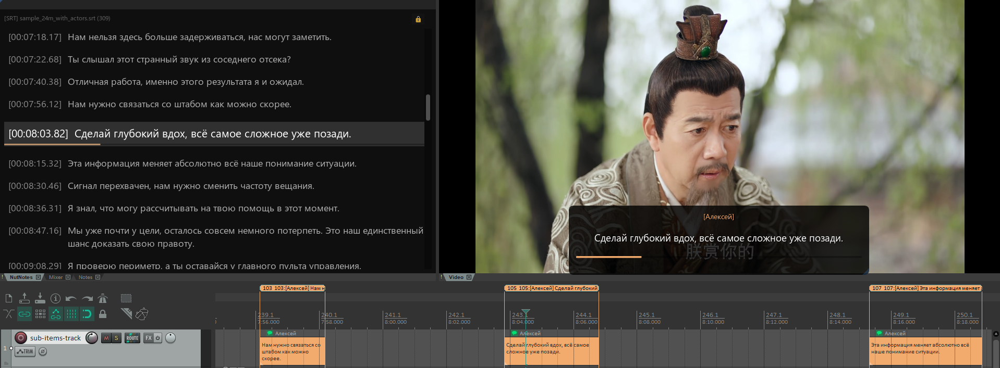

# 🌰 NutNotes (ASS & SRT Subtitles for REAPER)

**Инструмент для дубляжа, озвучки. Плагин для визуализации субтитров в Cockos REAPER.**

**Версия:** `0.5.0-beta`

**Автор:** BelkaVBanke

**Репозиторий:** [GitHub](https://github.com/BelkaVBanke/NutNotes)

NutNotes предлагает актерам озвучивания: список реплик с плавной автопрокруткой, фильтрация по Актерам, создание цветных регионов и айтемов, а также свободно передвигаемый оверлей спасет, если вам не отрендерили хардсаб.

ЧТОБЫ НАЧАТЬ работу, достаточно посмотреть [пункты 1-3 в 2.2](#usage-subtitles) и знать, что оверлей включается по нажатию БОЛЬШОЙ кнопки во вкладке "Оверлей" ^-^.

## Скриншот

---

## 📑 Содержание

1. [📥 Гайд по установке](#installation)
   - [Вариант 1: Автономный установщик Windows (Рекомендуется)](#setup-installer)
   - [Вариант 2: Кроссплатформенная ручная установка (рекомендуется для Linux и macOS)](#setup-zip)
   - [Настройка автозапуска и кнопки в REAPER](#setup-startup)
   - [Лицензирование сторонних библиотек](#third-party-licensing)
2. [📖 Гайд по использованию](#usage)
   - [2.1. Быстрый старт: загрузка субтитров](#usage-quickstart)
   - [2.2. Вкладка 1: «Субтитры»](#usage-subtitles)
   - [2.3. Вкладка 2: «База актеров»](#usage-actors)
   - [2.4. Вкладка 3: «Настройки текста»](#usage-typography)
   - [2.5. Вкладка 4: «Оверлей»](#usage-overlay)
   - [2.6. Вкладка 5: «Общие настройки» ](#usage-general)
   - [2.7. Управление таймлайном: Регионы и Track Items](#usage-timeline)
3. [🛠️ Поддерживаемые форматы](#formats)
4. [📄 Лицензия](#license)

---

## 📥 Гайд по установке

Выберите один из трех удобных способов установки:

### Вариант 1: Автономный установщик Windows (Рекомендуется)
Самый простой и быстрый способ установки — готовый инсталлятор **`NutNotes_Setup_vX.X.X.exe`**:
* **Всё включено**: автоматически разворачивает плагин, а также необходимые 64-битные зависимости (`reaper_imgui-x64.dll`, `reaper_reapack-x64.dll`, `reaper_js_ReaScriptAPI64.dll` и скрипты ReaTeam Extensions API), исключая необходимость ставить что-либо вручную.
* **Автоматическая регистрация экшена**: регистрирует команду в REAPER (`reaper-kb.ini`) — плагин сразу появляется в списке экшенов по клавише `?`.
* **Дополнительные опции**: прямо в мастере установки можно включить автозапуск скрипта при старте REAPER, добавить иконку на главную панель инструментов (Main Toolbar) и установить примеры субтитров.
* **Проверка версии GitHub/Git**:
  - При запуске установщик опрашивает GitHub API релизов репозитория.
  - Если на GitHub доступна более свежая версия, установщик уведомит об этом и предложит скачать и установить актуальную версию.
  - Если сеть отсутствует, GitHub недоступен или версии совпадают — устанавливается проверенная вшитая сборка.
  - Поддерживает безопасное обновление: очищает предыдущие исполняемые файлы и старые экшены, бережно сохраняя ваши проекты и конфигурацию.

---

### Вариант 2: Кроссплатформенный архив (macOS / Linux / Windows)
Готовый комплект для установки в REAPER без запуска инсталлятора:

#### Порядок установки:
1. **Шаг 1: Установка ReaPack (Менеджер пакетов)**
   - Скачайте `ReaPack` для вашей платформы с официального сайта [reapack.com](https://reapack.com/).
2. **Шаг 2: Установка ReaImGui (Графический движок)**
   - Через ReaPack: в меню REAPER откройте **Extensions -> ReaPack -> Browse packages...**, найдите `ReaImGui: ReaScript binding for Dear ImGui`, нажмите **ПКМ -> Install**, затем **Apply**.
3. **Шаг 3: Установка js_ReaScriptAPI (Экспорт файлов)**
   - Через ReaPack: в меню REAPER откройте **Extensions -> ReaPack -> Browse packages...**, найдите `js_ReaScriptAPI: API functions for ReaScripts`, нажмите **ПКМ -> Install**, затем **Apply**.
4. **Шаг 4: Установка скрипта NutNotes**
   - Скопируйте папку скрипта `NutNotes` (содержащую `NutNotes.lua`, `modules/`, `assets/`) в каталог `Scripts/` ресурсов REAPER:
     `{REAPER_RESOURCE_PATH}/Scripts/NutNotes/`
5. **Шаг 5: Регистрация экшена в REAPER**
   - Откройте **Actions -> Show action list...** (клавиша `?`).
   - Нажмите **New action... -> Load ReaScript...**
   - Выберите `{REAPER_RESOURCE_PATH}/Scripts/NutNotes/NutNotes.lua`.

---

### Настройка автозапуска и кнопки в REAPER
Управлять интеграцией можно прямо из интерфейса плагина (вкладка **«Общие настройки»** -> блок **«ИНТЕГРАЦИЯ С REAPER»**):
* **Автозапуск плагина при старте REAPER**: безопасный переключатель, прописывающий хук запуска в `Scripts/__startup.lua`.
* **Кнопка NutNotes на панели инструментов**: переключатель добавления/удаления иконки на главную панель (Чтобы изменения вступили в силу, требуется перезагрузка).

---

### ⚖️ Лицензирование сторонних библиотек
Для автономной работы установщик Windows включает бинарные файлы внешних библиотек:
* `reaper_imgui-x64.dll` (ReaImGui v0.10.0.5, автор: Christian Fillion) — распространяется по лицензиям **GNU LGPL v3 / GPL v3** (включает Dear ImGui под лицензией MIT и др.).
* `reaper_reapack-x64.dll` (ReaPack v1.2.6, автор: Christian Fillion) — распространяется по лицензии **GNU GPL v3**.
* `reaper_js_ReaScriptAPI64.dll` (js_ReaScriptAPI v1.310, автор: Julian Sader) — распространяется по лицензии **MIT**.

Все файлы являются официальными неизмененными сборками (хеши SHA-256 проверены). Полные уведомления об авторских правах, контрольные суммы, ссылки на исходный код и правила распространения приведены в файле [**`THIRD_PARTY_NOTICES.md`**](THIRD_PARTY_NOTICES.md), а оригинальные тексты лицензий — в папке [**`licenses/`**](licenses/).

---

## 📖 Гайд по использованию

### 2.1. Быстрый старт: загрузка субтитров

**ВНИМАНИЕ: На версиях REAPER до v7.62 в начале дорожки будет отображаться маркер необходимый для сохранения изменений внутри плагина, он не удаляется и не является багом - это временная мера для обратной совместимости версий. (Решений, кроме обновления версии REAPER до актуальной, на данный момент нет.)**

* **Drag & Drop**: просто перетащите файл `.ass` или `.srt` прямо в окно NutNotes (или в окно оверлея).
* **Кнопка загрузки**: нажмите кнопку «📁 Загрузить файл субтитров (.ass, .srt)» в шапке окна.
* **Строка информации о файле**: отображает формат бейджем, название файла (с умным сокращением при нехватке ширины), общее количество реплик и кнопку «Очистить».
* **Сохранение per-project**: все загруженные субтитры, правки, цвета актеров и фильтры сохраняются **внутри текущего проекта REAPER** (`Project Extension State`). При повторном открытии проекта ничего загружать не нужно.
* **Защита от перезаписи**: если в проекте уже есть субтитры, при закидывании нового файла появится диалог подтверждения.

---

### 2.2. Вкладка 1: «Субтитры»

1. **Фильтр актеров (чипы и выпадающий список)**:
   - В выпадающем меню сверху выберите нужного актера — он добавится в виде цветного чипа-бейджа.
   - Выбранные актеры фильтруются по правилу **«ИЛИ»** (показываются реплики любого из отмеченных персонажей).
   - Чтобы сбросить или убрать актера, нажмите крестик `✕` на его чипе или чекбокс во вкладке «База актеров».
2. **Экспорт субтитров (.ass)**:
   - Сохраняет файл .ass с текущей ролевкой, таймингами и текстом.
3. **Режим фокусировки (кнопка с замочком 🔒 / 🔓)**:
   - В правом верхнем углу находится кнопка замка. В режиме блокировки вкладки и панели управления скрываются, а список субтитров занимает 100% высоты окна, чтобы ничто не отвлекало от чтения текста.
4. **«Синхронизировать с фильтром»**: при смене фильтра актеров регионы и айтемы мгновенно пересоздаются только под выбранных персонажей.
5. **Поиск по субтитрам**:
   - Поле ввода предоставляет возможность регистронезависимого поиска по тексту субтитров.
6. **Список реплик**:
   - Отображаются тайминги начала реплики `[ЧЧ:ММ:СС.сс]`, опциональный темп речи (CPS), имя актера и текст.
   - **Правило одного актера (Single Actor Rule)**: если выбран ровно один актер, весь его текст отображается чистым белым цветом (`0xFFFFFFFF`) для максимального фокуса. Если выбрано несколько актеров — реплики подкрашиваются в цвета каждого актера.
7. **Навигация и прыжки по клику**:
   - Клик по строке субтитра мгновенно переводит курсор воспроизведения на начало фразы.
   - Если в момент клика шло воспроизведение, воспроизведение не сбивается, а переходит на выбранную реплику.
8. **Контекстное меню (ПКМ по строке)**:
   - **✏️ Изменить текст...**: открывает компактное стилизованное модальное окно. Нажмите `Ctrl+Enter` для быстрого сохранения или `Esc`.
   - **🎭 Изменить актера**: переназначение реплики на существующего или нового актера.
   - **🗑️ Удалить строку**: удаление реплики из проекта с поддержкой истории отмены/повтора (Undo/Redo) и синхронным удалением региона или айтема на таймлайне.
9. **Горячие клавиши (Хоткеи)**:
   - `Delete` / `Backspace` — быстрое удаление выбранной строки в списке субтитров. Если под удаляемой строкой нет наложения (overlap), выделение автоматически сбрасывается для защиты от случайного каскадного удаления следующих строк при автоскролле.
   - `Shift+T` (или `T`) — создание нового субтитра по выделенному диапазону времени (Time Selection) на таймлайне REAPER.
10. **Полная интеграция с Undo/Redo REAPER**:
   - Создание, правки и удаление субтитров синхронизированы со стеком отмены REAPER (`Ctrl+Z` / `Ctrl+Y`) — при отмене строки списка, регионы и айтемы синхронно восстанавливаются без дублирования.

---

### 2.3. Вкладка 2: «База актеров»

1. **Умный парсинг имен**:
   - Автоматически распознает комплексные заголовки вида `Актер - Персонаж` и реплики с несколькими актерами (`АктерА; Актер Б - Коюки Хикава; Цукико Симодзима`).
2. **Палитра по 360-градусному цветовому кругу**:
   - Цвета актеров автоматически распределяются по спектру.
3. **Кастомизация цвета**:
   - В столбце «Цвет» можно кликнуть по цветовому полю любого актера и выбрать персональный цвет через палитру.
4. **Статистика**:
   - Отображается точное число реплик каждого актера и процент от общего объема текста.
5. **Контекстное меню (ПКМ по актеру)**:
   - **✏️ Переименовать актера...**: глобальное переименование актера во всех связанных репликах проекта с сохранением цвета.
   - **🔗 Объединить с другим актером**: слияние нескольких дубликатов в одного диктора.

---

### 2.4. Вкладка 3: «Настройки текста»

Позволяет адаптировать отображение строк под ваш вкус:
* **Стандартные настройки текста**: выбор гарнитуры шрифта и базового размера.
* **Точка центрирования экрана**: ползунок высоты, на которой фиксируется текущая строка (от 20% до 80% высоты окна).
* **Дифференциация по актерам**:
  * Чекбокс «Подкрашивать строки цветом актера» (а также выбор цвета текста по умолчанию).
  * Чекбокс «Показывать имя актера в строке субтитра».
  * Чекбокс «Подкрашивать имена актеров в их цвет».
* **Отображение темпа речи (CPS — Characters Per Second)**:
  * Чекбокс показа бейджа скорости речи (символов в секунду) в списке реплик и в окне предпросмотра.
  * Цветовая дифференциация темпа: зелёный (<15 CPS — спокойная речь), нейтральный/белый (15–18 CPS — стандартный темп дубляжа 17 CPS), оранжевый/красный (>18 CPS — высокая плотность текста).
* **Синхронизация удержания реплик с оверлеем**:
  * Чекбокс синхронизации (включен по умолчанию). Если в оверлее активен режим удержания, строка в списке остаётся активной на протяжении всего реального времени показа (Hold Time).
  * Полоса прогресса удерживаемой реплики меняет цвет на янтарно-золотой и отображает добавленное время (+X.Xs).
  * Предпрокрутка (lead-in) следующей реплики плавно подсвечивает её заранее, а автопрокрутка переходит на новую строку строго в момент завершения удержания текущей фразы.
* **Выделение текущей строки**:
  * Чекбокс и масштаб шрифта текущей строки (увеличение активной строки до 1.50x).
  * Чекбокс и отступ перед/после текущей строки.
  * Яркость подсветки фона активной реплики.
* **Режим зебры**: чередование яркости фона четных и нечетных строк с настройкой контрастности.
* **Lead-in time (предпрокрутка)**: строка начинает подсвечиваться за n секунд до начала фразы.
* **Плавная автопрокрутка (Smooth Scroll)**: автопрокрутка плавно скроллит список без резких скачков (с регулировкой скорости).
* **Интерактивное превью**: блок «Предпросмотр текста» наглядно показывает текущее оформление строк в реальном времени с демонстрацией разницы CPS и стилей (кнопка «Свернуть» / «Развернуть»).
* **Кнопка сброса**: возврат всех параметров оформления текста к стандартным значениям.

---

### 2.5. Вкладка 4: «Оверлей»

Плавающее прозрачное окно для размещения прямо поверх окна видеоряда:
* **Без рамок и кнопок**: перемещается мышью за любой участок фона, изменяет размер за правый нижний край.
* **Режим «Поверх всех окон» (Always on top)**: удерживает оверлей видимым над полноэкранным видео.
* **Умные режимы удержания реплик (Hold Mode)**:
  * *Выключен (строгий тайминг)* — субтитр исчезает точно по таймингу региона.
  * *Только в паузах (без сдвига, по умолчанию)* — если фраза длинная (темп превышает целевой CPS), показ реплики задерживается на экране во время паузы перед следующей фразой (до заданного лимита).
  * *Каскадный сдвиг с наложением* — при плотном диалоге показ реплики задерживается на экране даже без паузы, каскадно сдвигая показ следующей реплики вперед до ближайшей паузы на таймлайне.
  * *Параметры удержания*: целевой темп речи (базовый 17.0 симв/сек), максимальное удержание на реплику (по умолчанию 1.5 с) и предел накопления каскадного сдвига (по умолчанию 2.5 с).
  * *Бейдж отставания (`+X.Xs`)*: янтарный индикатор в оверлее при задержке фразы.
* **Отображение имени персонажа в оверлее**:
  * Выбор расположения бейджа: сверху над репликой или слева в одну строку с текстом.
  * Макет расположения (в одну линию или сетка) и настройка отступа между именем и фразой.
  * Автоматическое скрытие имени при фильтрации по одному актеру (Single Actor Rule).
* **Предпоказ следующей строки**: выводится в одной компактной строке вида `[Имя] Текст следующей фразы` с плавным обратным отсчетом в паузах (режим телесуфлера).
* **Подкрашивание реплик**:
  * «Подкрашивать реплики» — окрашивает текст оверлея в цвет говорящего актера.
  * «Подкрашивать только свои реплики» — оставляет чужие фразы белыми, а реплики выбранного актера выделяет цветом.
* **Кастомизация текста и фона оверлея**:
  * Раздельная настройка размеров шрифта для основной фразы, имени актера и следующей реплики.
  * Настройка цвета фона и прозрачности (Alpha), опция скрытия полосы прогресса.
  * Выравнивание текста (по левому краю, по центру, по правому краю).
* **Кнопка сброса**: возврат всех настроек оверлея к значениям по умолчанию.

---

### 2.6. Вкладка 5: «Общие настройки»

* **Акцентный цвет интерфейса**: выбор цвета плагина (пресеты: Изумруд, Синий, Бирюза, Янтарь, Пурпур или произвольный цвет через палитру).
* **Стиль карточек и панелей**: выбор контраста панелей настроек.
* **Интеграция с REAPER**:
  * Автозапуск плагина при старте REAPER.
  * Кнопка NutNotes на главной панели инструментов REAPER.
* **Горячие клавиши (Хоткеи)**:
  * Выбор комбинации для создания субтитра по Time Selection (`Shift+T` по умолчанию или `T`).
  * Работает устойчиво независимо от активного языка/раскладки клавиатуры и переключения окон (`Alt+Tab`).
* **Оптимизация: Динамическая подгрузка регионов и айтемов (Dynamic Streaming)**:
  * Потоковый режим создания регионов и айтемов в REAPER только в пределах заданного радиуса времени вокруг курсора воспроизведения.
  * Настраиваемый радиус времени (по умолчанию ±5 минут вокруг курсора).
  * Настраиваемый порог включения по количеству строк (по умолчанию активируется для проектов от 3000 строк).
  * Исключает лаги и подвисания REAPER при работе с крупными проектами и аудиокнигами на десятки тысяч строк.
* **Масштаб шрифтов интерфейса**: ползунки для шрифта интерфейса/таблиц, всплывающих меню и подсказок.
* **Кнопка сброса**: сброс масштабов, палитры и акцента по умолчанию.
* **СУПЕР-МЕГА-ВАЖНАЯ КНОПКА**: кнопка «Поддержать» в самом низу общих настроек 👉🏻👈🏻.

---

### 2.7. Управление Регионами и Track Items

Нижняя панель действий позволяет синхронизировать сценарий с проектом REAPER:
* **🚩 Задать регионы**: создает регионы проекта на основе субтитров с именами `[Актер] Текст` и цветами актеров.
* **🗑️ Очистить регионы**: удаляет все регионы проекта.
* **🎞️ Создать items**: находит или создает трек с именем `sub-items-track`, нарезает айтемы по таймингам, записывает реплику в заметки.
* **🗑️ Очистить трек**: удаляет все айтемы с дорожки субтитров.
* **Поддержка динамического потокового режима**: при включенной динамической подгрузке регионы и айтемы создаются в пределах активного временного радиуса и бесшовно обновляются по ходу воспроизведения и перемотки.

---

## 🛠️ Поддерживаемые форматы и парсинг

### Формат ASS (.ass / .ssa)
* Считывает секцию `[Events]`.
* Автоматически определяет порядок столбцов из строки `Format:`.
* Очищает теги оформления ASS: `{\an8}`, `{\b1}`, `{\c&HFFFFFF&}` и др.
* Преобразует служебные разделители `\N` и `\n` в стандартные переносы строк.
* Удаляет невидимые Unicode-символы (BOM, LRM, RLM), предотвращая сбои кодировки.

### Формат SRT (.srt)
Автоматически извлекает имена персонажей по всем распространенным стилям:
1. `Имя: Текст реплики` (двоеточие после имени).
2. `[Имя] Текст реплики` (квадратные скобки).
3. `(Имя) Текст реплики` (круглые скобки).
4. `<v Имя>Текст реплики</v>` (голосовой тег WebVTT/SRT).
5. Если префикс отсутствует — строке присваивается статус `NoActor`.
---

## 📄 Лицензия

Плагин NutNotes распространяется под лицензией **GNU General Public License v3.0 (GPL-3.0)**. См. полный текст в файле [LICENSE](LICENSE).

### Сторонние компоненты и зависимости
Автономный установщик включает сторонние бинарные компоненты:
* **ReaImGui v0.10.0.5** (автор: Christian Fillion) — GNU LGPL v3 / GPL v3. [Исходный код ReaImGui v0.10.0.5](https://github.com/cfillion/reaimgui/tree/v0.10.0.5).
* **ReaPack v1.2.6** (автор: Christian Fillion) — GNU GPL v3. [Исходный код ReaPack v1.2.6](https://github.com/cfillion/reapack/tree/v1.2.6).
* **js_ReaScriptAPI v1.310** (автор: Julian Sader) — MIT License. [Исходный код js_ReaScriptAPI](https://github.com/juliansader/js_ReaScriptAPI).

Подробное описание авторских прав, тексты лицензий, контрольные суммы SHA-256 и информация о предоставлении исходного кода доступны в файле [**THIRD_PARTY_NOTICES.md**](THIRD_PARTY_NOTICES.md) и каталоге [**`licenses/`**](licenses/).
